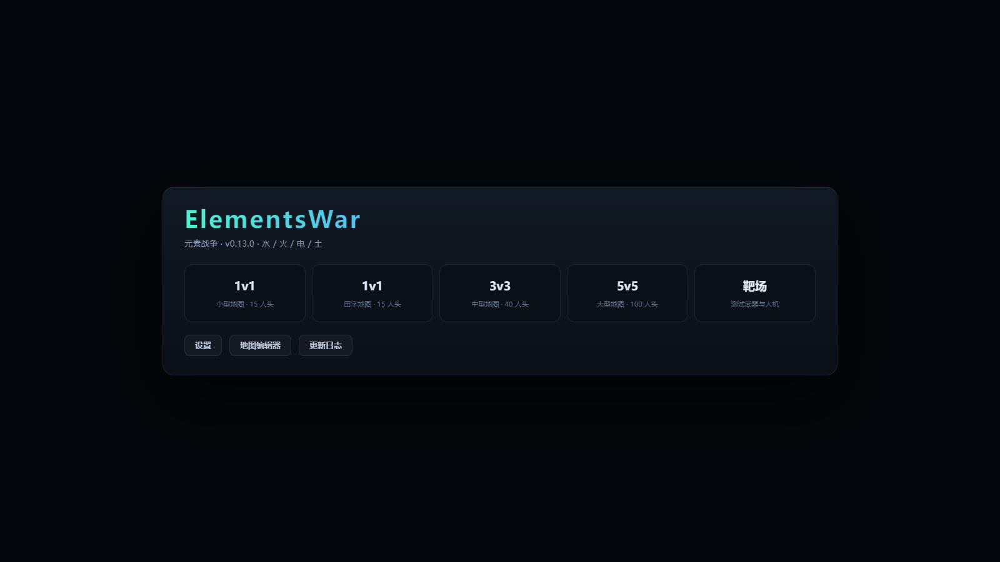
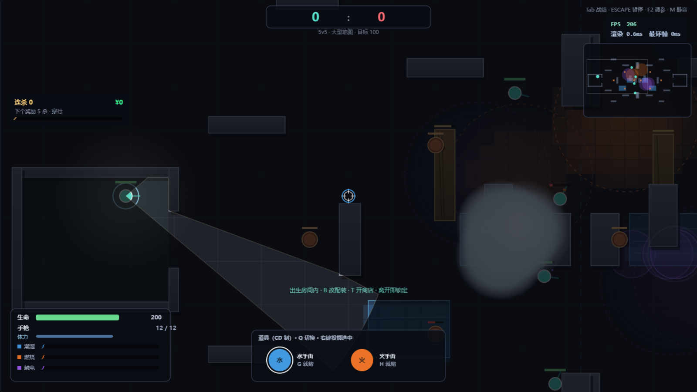
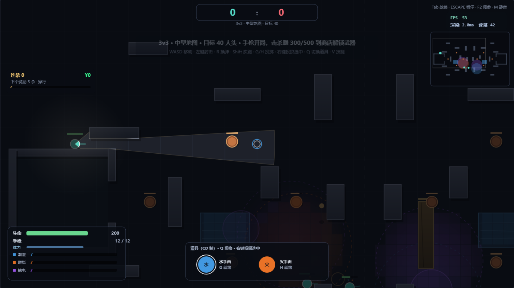

# 元素战争 · ElementsWar

> 一款以「元素地形」为核心机制的 2D 俯视角战术射击 Demo。
> 玩家不是在捡元素，而是在**用元素改写战场**——铺水、点火、放电，让地面本身成为武器。

**[▶ 在线试玩](http://101.43.113.112/)**　·　单机 5v5 / 3v3 / 1v1 对战 AI　·　无需注册，打开即玩




---

## 目录

- [1. 一句话定位](#1-一句话定位)
- [2. 核心设计：元素系统](#2-核心设计元素系统)
- [3. 三条关键规则，以及它们为什么存在](#3-三条关键规则以及它们为什么存在)
- [4. 战斗与配装](#4-战斗与配装)
- [5. 信息即资源：视野与迷雾](#5-信息即资源视野与迷雾)
- [6. 连杀系统](#6-连杀系统)
- [7. 迭代记录：用证据改设计](#7-迭代记录用证据改设计)
- [8. 数值与调参](#8-数值与调参)
- [9. 已知问题与下一步](#9-已知问题与下一步)
- [10. 技术说明](#10-技术说明)

---

## 1. 一句话定位

**类型**：2D 俯视角 · 战术射击 · 元素策略
**单局时长**：3–6 分钟（1v1 首杀 15，5v5 目标 100 杀）
**目标体验**：*每一次交火前，玩家都要先改造地形*——而不是单纯比谁枪法快

设计上刻意让「枪」和「元素」形成分工：

- 枪负责**即时压制**（点杀暴露的敌人）
- 元素负责**制造优势**（封锁路线、逼出掩体、连锁反应）

如果两套系统只是并列，玩家会永远选更强的那一套。所以经济系统上做了倾斜（见第 4 节）：**元素击杀 500 元，枪械击杀 300 元**——用数值引导行为，让"想赢"和"想用元素"指向同一个方向。

---

## 2. 核心设计：元素系统

### 三层模型

```
区域 (Zone)     手雷落点 → 一个带「燃料」的圆
  ↓ 每帧烘焙
场 (Field)      30px 网格，每格记录 水/火/电 三种浓度
  ↓ 每帧结算
格子反应 (Cell) 浓度越过阈值 → 触发反应、消耗燃料
```

**为什么用网格而不是纯圆形区域？**
圆形只能表达"这里有一坨水"，无法表达**两块区域重叠处浓度更高**。网格让"叠加"这件事变得可计算——这也是整个系统能谈"规则"而不是"特效"的前提。

### 元素与反应

| 元素 | 附着状态 | 参与反应 |
|---|---|---|
| 水（蓝） | 潮湿 · 减速 | 蒸发、感电、泥沼 |
| 火（橙） | 燃烧 · 持续伤害 | 蒸发、超载 |
| 电（紫） | 触电 · 麻痹 | 感电、超载 |
| 土（黄） | 泥沼 · 强减速 + 吸水 | 与水互斥 |

| 组合 | 反应 | 效果 |
|---|---|---|
| 水 + 火 | **蒸发** | 范围爆发伤害 + 生成遮挡视野的雾 |
| 水 + 电 | **感电陷阱** | 麻痹，站在水里会被反复触发 |
| 火 + 电 | **超载爆炸** | 高伤 + 击退，把人炸出掩体 |
| 水 + 火 + 电 | **三相共鸣** | 三种元素同时存在时的复合爆发 |
| 土 + 水 | **泥沼** | 吸水、强减速，是唯一「防御型」元素 |

> 反应的伤害**归属最后触发者**——所以"我铺的水，队友点的火"依然算队友的击杀，但双方都能从元素击杀的更高经济中获益。



---

## 3. 三条关键规则，以及它们为什么存在

这三条是开发过程中专门讨论并锁定的，它们决定了元素系统的**深度上限**。

### 规则一：三相共鸣 —— 复合反应，而不是两两叠加

三种元素重叠时，只产生**一个**三相共鸣，**不会**同时结算"水火""水电""火电"三次反应。

**为什么**：如果允许两两叠加，三种元素重叠的收益是单种的 3 倍，玩家会退化成"把所有雷都扔一个点"，游戏的策略维度直接塌成"堆料"。规则一让"三相"成为**需要精确控制的结果**，而不是无脑收益。

### 规则二：木桶法则 —— 反应强度取两元素的较小浓度

反应强度 = `min(浓度A, 浓度B)`。

**为什么**：如果取较大值或相加，同种元素反复叠加就会线性变强，最终所有战术收敛成"再扔一个水雷"。取较小值意味着：

- 同一片水再多，也只是一个"资源池"
- 想放大反应，必须**同时**把另一种元素也堆上去
- 于是"铺场"代替"堆叠"，战场变成一张需要经营的图

### 规则三：燃料回写区域 —— 反应消耗的是「区域」，不是「格子」

反应扣的是所属区域的燃料，而不是把格子的浓度清零。

**为什么**：早期实现是"每格每次触发消耗 30 燃料"，结果是——

> 一片水域在一帧内被 40 个格子各触发一次，燃料瞬间归零，同时产生几十个重叠爆炸。

改成**连通块结算**（相同反应类型的格子做 4 邻接洪泛，一个连通块只触发一次，强度按 `√面积` 缩放）之后，既解决了性能问题，也让反应有了"规模感"：一大片水被点燃是一声闷响，而不是机关枪。

燃料回写的附带好处是**水能灭火**——往火区里丢水雷，火区燃料被吸干，这是玩家自然能理解的行为。

---

## 4. 战斗与配装

### 武器（8 把，各有明确定位）

| 定位 | 武器 | 特点 |
|---|---|---|
| 全能 | 步枪 | 万金油，中等 DPS |
| 近战爆发 | 霰弹枪 | 8 弹丸，贴脸 300+ DPS |
| 冲锋 | 冲锋枪 | 高射速、低单发 |
| 持续 | 轻机枪 | 75 发弹匣，移动时散布惩罚大 |
| 精确 | 精确射手步枪 | 半自动，中远距离 |
| 一击 | 狙击枪 | 95 伤害 + 穿透 3 人 |
| 免费 | 手枪 | 开局武器，12 发 |
| 近身 | 长刀 | 118px 范围，背刺 ×2，附带弹药元素 |

长刀是刻意的"资源穷尽"设计：没钱时的保底手段，但贴脸风险高。

### 经济：用数值引导行为

```
枪械击杀      +300
元素/反应击杀  +500   ← 高出 67%
武器解锁     500 ~ 1000
天赋         1500 ~ 3000
```

这 67% 的差额是整个 Demo 里**最重要的一次数值设计**。它解决了一个常见问题：*"如果元素只是枪的附庸，玩家为什么不用枪？"*
答案不是削弱枪，而是让元素击杀更容易滚起经济雪球。

### 天赋与防具（单局有效，死亡不清除金钱）

| 天赋 | 价格 | 效果 |
|---|---|---|
| 击杀回血 | 1500 | 每次击杀回复 20% 生命 |
| 橡胶子弹 | 3000 | 子弹撞墙弹射一次 |
| 鹰眼视野 | 2000 | 视野距离 ×1.4、角度 ×1.3 |
| 第三只眼 | 2400 | 获得 110° 背后视野（射程 55%） |

防具二选一（**本局锁定**，逼迫中期做取舍）：再生护甲 50（脱战回血）/ 重型护甲 100（不可恢复）。

道具为 CD 制（基础 8 秒），每人限带 2 件——限制"道具海"，让每次投掷都是决策。

---

## 5. 信息即资源：视野与迷雾

这是第二个核心系统。**战争迷雾不是装饰，是玩法**：

- 每个单位有**视锥**（射线检测遮挡），被墙体切断
- 视野外完全不可见，雾中的敌人也不可见
- 听声辨位：枪声、爆炸会在小地图上指示大致方向

因此"信息"成了和血包、子弹并列的资源：

| 天赋/技能 | 信息价值 |
|---|---|
| 鹰眼视野 | 看得更远、更宽 |
| 第三只眼 | 消除**背后**盲区（110°） |
| 全图视野（连杀 9） | 12 秒全图透视 |
| 蒸发产生的雾 | **反向价值**：遮蔽所有人，包括自己 |

雾既能帮人也能害人，这是我最满意的一处"双刃"设计。

---

## 6. 连杀系统

| 连杀数 | 奖励 | 设计意图 |
|---|---|---|
| 5 | 穿行 6.5s（可穿墙，但子弹仍被挡） | 逃生 / 绕后，奖励连续击杀 |
| 9 | 全图视野 12s | 掌握节奏，反打 |
| 13 | 空袭 | 清点，但需要视野引导 |
| 20 | 无畏战士 15s（射速 +50%、800 护盾） | 滚雪球终点 |

**规则**：同时只能持有 1 个，死亡不丢，连杀计数死亡重置。
限制"只能存一个"是为了防止玩家攒一堆技能一波推平——奖励要即时兑现，否则节奏会断。

---

## 7. 迭代记录：用证据改设计

> 这一节记录的是真实发生过的设计迭代，包括我推翻自己的部分。

### ① 反应"爆炸"了 → 连通块结算

**现象**：一片水域被点燃时，一帧内产生几十个重叠爆炸，画面全白、帧率归零。
**诊断**：按格子逐个结算，每格独立消耗燃料。
**改动**：相同反应类型做 4 邻接洪泛，**一个连通块只触发一次**，强度按 `√面积` 缩放，燃料按 `8 + 面积×0.14` 扣除。
**结果**：性能恢复，而且反应有了"规模感"——大水体是一声闷响，小火苗是噼啪爆响。

### ② 反应伤害不算击杀

**现象**：所有元素击杀都显示为"环境"。
**诊断**：计算"最后触发者"的函数在**区域燃料被消耗之后**才调用，此时区域已经归零，找不到归属。
**改动**：把归属计算提到消耗之前。
**结果**：元素击杀正常计入 500 元经济——这条直接影响第 4 节的经济设计能否成立。

### ③ 联机手感：从"橡皮筋"到回滚重放

**现象**：单机 60fps 很稳，一旦联机，移动时自己的角色在原地高频微抖。
**诊断**：旧实现每收到一个快照就把预测位置往服务器位置**拉 22%**——而服务器位置永远比预测晚半个 RTT，于是形成 15Hz 的来回拉扯。
**改动**：换成标准的「输入缓冲 + 回滚重放」：服务器每个 tick 消费一条输入并回传 `ack`，客户端从服务器位置出发重放**所有未确认输入**。
**结果**：抖动从原理上消失（不再需要"拉回"这个动作）。

### ④ "视野卡顿"的误判

**现象**：晃动视野时掉帧，我一度判断"视野计算太重"，准备把计算搬到服务器。
**诊断**：先测——`computeVision` 单次 **0.015ms**，完整一帧逻辑 **0.27ms**，占 60fps 预算的 1.6%。**计算根本不是瓶颈。**
**真因**：① 每帧重建 42 个顶点数组（每秒约 2.6 万个小对象 → GC 停顿）；② 雾效每帧把整屏画到离屏画布再贴回（60fps 下约 280MB/s 的纹理上传）。
**改动**：视锥顶点数组复用、雾效改为单次 `even-odd` 路径填充（去掉离屏画布）、颜色字符串缓存。
**收获**：这次教训是**先测量再动手**——如果当时真把视野搬到服务器，会平白增加 RTT 延迟和带宽，还解决不了问题。

### ⑤ 出生保护永不消失

**现象**：玩家离开出生区后仍然免疫伤害。
**诊断**：清除保护的代码写在了 `if (wasIn)` 分支里——只有"还在出生区"时才会执行，于是永远不触发。
**改动**：改为在"离开出生区"时清除。

每次迭代我都保留自动化测试（当前 **42 项**，覆盖元素反应、连通块、延迟补偿、经济、视野等），改数值或改逻辑后一键回归。

---

## 8. 数值与调参

所有关键参数集中在 `js/core.js` 的 `CFG` 里，共 40+ 项，例如：

| 参数 | 值 | 含义 |
|---|---|---|
| `theta` | 25 | 触发反应的最低浓度 |
| `zoneR` / `zoneFuel` | 150 / 100 | 手雷区域半径与燃料 |
| `unitHp` | 200 | 基础生命 |
| `statusThreshold` | 40 | 状态触发阈值 |
| `bulletStatus` | 20 | 子弹每次命中的元素附着量 |
| `respawn` | 4s | 复活时间 |

游戏内按 **F2** 打开调试面板，可以实时拖动这些参数（伤害倍率、视野距离、AI 误差、连杀半径等），改完立刻能感受到差异——调参时不用反复改代码重启。

按 **F1** 可以叠加显示元素浓度网格，调试"为什么这片区域不反应"很有用。

---

## 9. 已知问题与下一步

作为 Demo，以下是明确未完成的部分：

**平衡性**
- 开局全员手枪的阶段偏长，首杀到来慢（计划：出生给一把基础步枪）
- 霰弹枪在贴脸距离的 DPS 优势过大（300+），计划削弱换弹速度
- 长刀 118px 的攻击距离是否够用，还需要更多实战验证

**系统**
- 新手引导缺失：元素、天赋、连杀三个系统同时抛给玩家，理解成本偏高
- 存档缺失：每局从手枪开始，武器解锁不跨局保留（对 Demo 是缺点）
- 元素网格的视觉表现偏"工程化"，缺少浓度渐变的艺术处理

**联机（已暂停）**
代码完整保留（`server/` + `js/net.js`），包含视野裁剪、延迟补偿、输入回滚。当前线上版本是纯单机，`js/build.js` 一个开关即可恢复。

---

## 10. 技术说明

> 这一节给想看实现的人，不影响对设计的评估。

- **纯前端**：单个 HTML + 原生 JS，**无构建、无框架、无依赖**，双击 `index.html` 即可运行
- **核心与渲染分离**：`js/core.js` 完全不依赖 DOM，可直接在 Node 里跑逻辑测试
- **零依赖服务端**：联机版自己实现了 WebSocket 协议（握手 + 帧编解码），服务器上不需要 `npm install`
- **自动化测试**：`node tools/smoke.js` 跑 42 项断言
- **地图编辑器**：`editor.html`，支持左右镜像 / 中心对称，导出后可直接进游戏

```
index.html        游戏入口
editor.html       地图编辑器
js/core.js        游戏核心（无 DOM 依赖）
js/main.js        渲染 / 输入 / 界面
js/build.js       构建开关（NET_ENABLED）
server/           联机服务端（零依赖 WebSocket）
tools/            测试与开发工具
design/           设计文档与脚本
```

---

## 关于这个 Demo

这是一个**以系统设计为主**的作品：相比"再加十把枪"，我更想验证的是
*「规则能否让玩家自然产生战术多样性」*。

上面的三条规则（三相共鸣 / 木桶法则 / 燃料回写）不是拍脑袋定的，而是先讨论清楚"如果放任会怎样"，再倒推出约束。

如果你在看完后能说出"我会怎么改这条规则"，那这个 Demo 的目的就达到了——欢迎交流。

**License**：MIT
